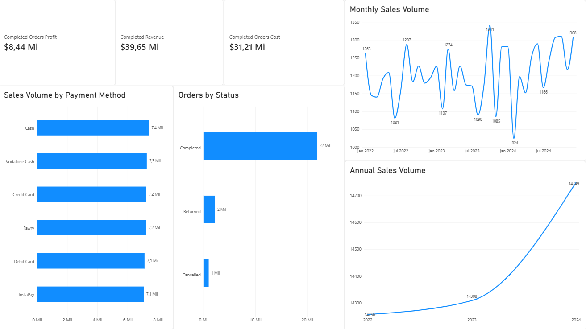
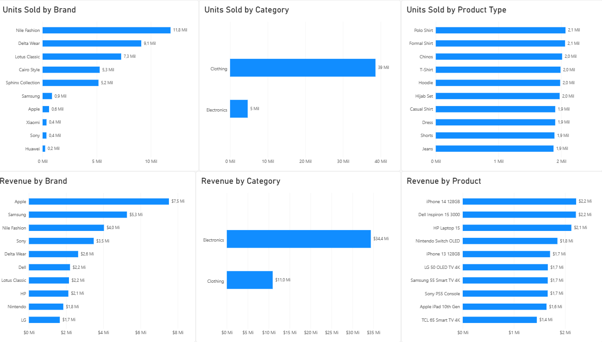
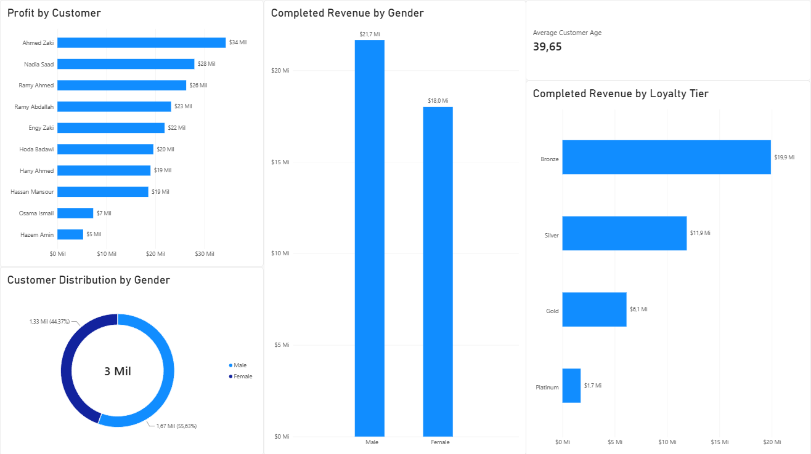
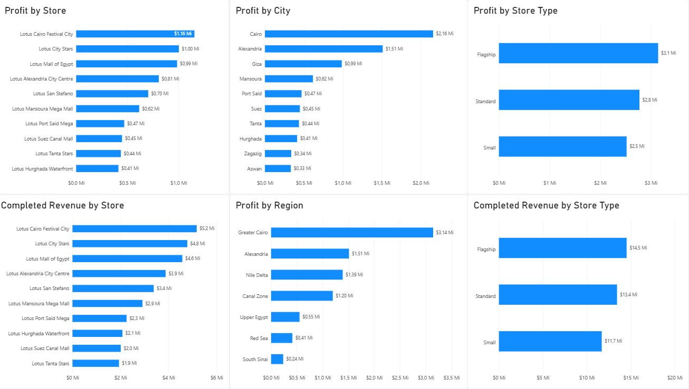
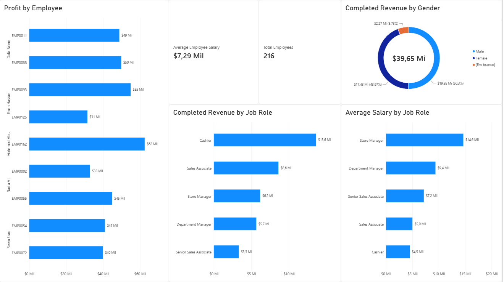
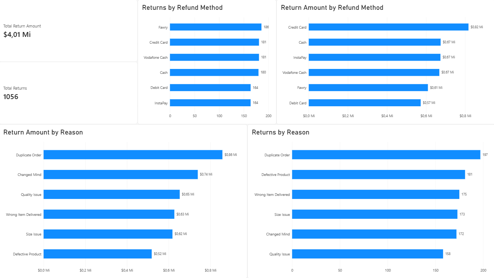

# Lotus Group Retail | Power BI

## Project Overview

This project presents an analysis of Lotus Group Retail using Power BI. It explores sales performance, product performance, customer behavior, store operations, employee performance, and product returns.

The analysis aims to provide an overview of the company's business operations, identifying relevant patterns, financial results, and opportunities for operational improvement.

## Objectives

- Analyze overall sales performance, including revenue, costs, profit, and payment methods.
- Evaluate product performance across brands, categories, and individual products.
- Explore customer characteristics, gender distribution, and loyalty tiers.
- Assess store performance across locations, regions, and store types.
- Examine employee revenue contributions and salary distribution across job roles.
- Analyze product returns by reason, refund method, and returned merchandise value.
- Identify business opportunities based on the findings.

## Tools & Technologies

- **Power BI Desktop** – Data visualization and dashboard development.
- **Power Query** – Data preparation and transformation.
- **DAX** – Calculated measures and analytical calculations.

## Data Sources

The project uses the Lotus Group Retail dataset, containing information about sales transactions, products, customers, stores, employees, and product returns.

## Project Structure

The project is organized into six analytical dashboards and a conclusion page:

1. **Sales Overview** – Revenue, costs, profit, payment methods, order status, and sales volume trends.
2. **Product Performance** – Units sold and revenue by brand, category, and product.
3. **Customer Analytics** – Customer distribution, revenue by gender, average age, and loyalty tier performance.
4. **Store Performance** – Profit and revenue analysis by store, city, region, and store type.
5. **Employee Performance** – Profit by employee, revenue by job role and gender, and salary analysis.
6. **Returns Analysis** – Return volume, returned merchandise value, refund methods, and return reasons.
7. **Conclusion** – Final analysis and business insights.

## Data Preparation & Modeling

Data preparation and analytical calculations were performed using Power Query and DAX in Power BI.

The process supported the development of analytical measures and visualizations covering sales, products, customers, stores, employees, and returns.

The analysis also considered data limitations, particularly regarding employee identification and the interpretation of revenue contributions across different job roles.

## Key Findings

### Sales Performance
- Completed revenue reached approximately **EGP 39.65 million**, with EGP 31.21 million in costs.
- Gross profit reached approximately **EGP 8.44 million**, representing a gross margin of **21.29%**.
- Cash and Vodafone Cash lead in sales volume among payment methods.
- Monthly sales volume fluctuates throughout the analyzed period.

### Product Performance
- Clothing dominates sales volume, with approximately **39,000 units sold**.
- Electronics generates approximately **EGP 34.4 million in revenue**, compared with EGP 11 million from Clothing.
- Apple and Samsung are among the strongest brands in revenue generation.
- iPhone 14 128GB and Dell Inspiron 15 3000 are among the leading products by revenue.

### Customer Analytics
- Male customers contribute approximately **EGP 21.7 million** in completed revenue, while female customers contribute around EGP 18 million.
- The average customer age is approximately **39.65 years**.
- Bronze customers generate the highest revenue among loyalty tiers, followed by Silver and Gold.
- The customer base consists of approximately 3,000 individuals.

### Store Performance
- Lotus Cairo Festival City leads individual stores in completed profit, generating approximately **EGP 1.16 million**.
- Cairo leads in total completed profit by city, with approximately EGP 2.2 million.
- Flagship stores generate the highest completed revenue, at approximately **EGP 14.5 million**.

### Employee Performance
- The dataset contains **216 employees**.
- Cashiers generate the highest completed revenue by job role, followed by Sales Associates.
- Store Managers have the highest average monthly salary, at approximately **EGP 14,600**.
- Employee revenue contributions vary across job roles and should not be interpreted as individual performance measures without considering additional operational factors.

### Returns Analysis
- The company recorded **1,056 returns**, representing approximately **EGP 4.01 million** in returned merchandise value.
- Duplicate Orders represent the largest return reason by value, accounting for approximately EGP 860,000.
- Credit Card refunds account for the highest returned amount, at approximately **EGP 820,000**.

## Dashboard Pages

### 1. Sales Overview

### 2. Product Performance

### 3. Customer Analytics

### 4. Store Performance

### 5. Employee Performance

### 6. Returns Analysis

For a more detailed discussion of the findings and business insights, see:

- [Lotus Group Retail - Conclusion (English)](Lotus-Group-Retail-Conclusion.md#english)
- [Lotus Group Retail - Conclusão (Português)](Lotus-Group-Retail-Conclusao.md#português)
